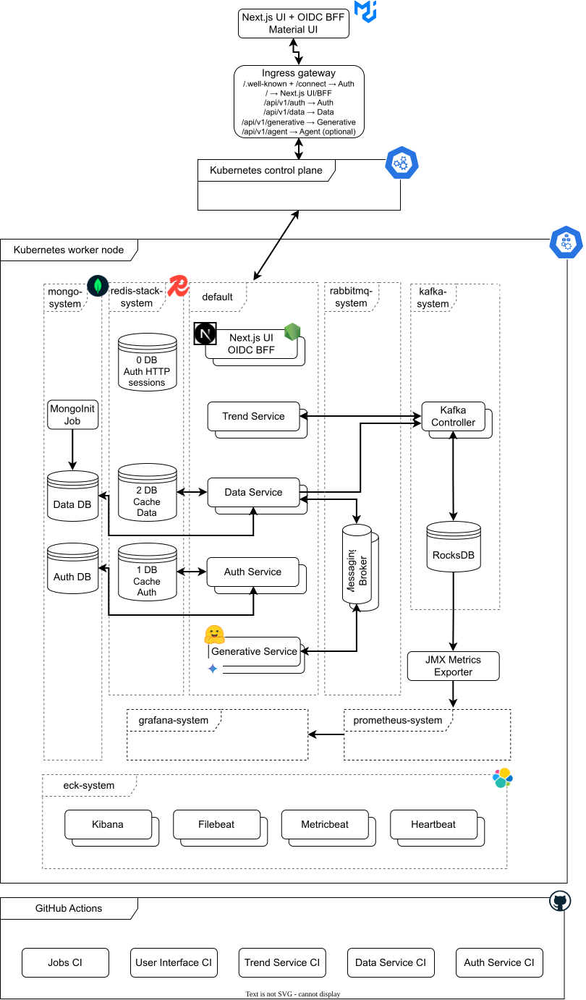

# Kino

Kino ("Cinema"), derived from German Kino and also reflected in Yiddish as קינאָ (kino), represents a personal educational initiative focused on exploring various technologies within the context of a cinema.

## Provision

Bring up a local Kino environment in this order. If you already have the seed
and Terraform inputs, start at **Start the cluster**.

### 1. Prepare the IMDb seed

Use an existing seed release digest, or publish one from the repository root:

```bash
(cd jobs && task release-imdb-titles-mongo-seed)
```

Copy `mongoSeedImageRef` from `jobs/.artifacts/release-manifest.json`. Set it as
`TF_VAR_mongodb_seed_image_ref` in the Terraform `.env` file. See the [IMDb titles release guide](jobs/README.md) for details.

### 2. Fill in Terraform inputs

From the repository root, create `.env` once and edit it before the first deploy:

```bash
cd orchestrators/k8s/terraform
test -e .env || cp .env.example .env
```

- Set `TF_VAR_mongodb_seed_image_ref` to the seed digest from Step 1.
- Replace each enabled service's sample `TF_VAR_*_image_ref` with its
  digest-pinned ref from a successful GitHub Actions release run.
- Replace the sample passwords and client secrets. Ticketing and Viewing Plans
  are enabled by default, so fill in their database role passwords.
- Set `TF_VAR_gemini_api_key` for the default Google model. Add an NVIDIA key
  only if you switch the agent provider to NVIDIA.

### 3. Start the cluster

From `orchestrators/k8s/terraform/`, run this on first setup and after a
computer restart:

```bash
task bootstrap-local-env
```

It checks host capacity, starts or prepares the six-CPU / 14-GiB Calico
Minikube profile, and updates local host entries. Enter your sudo password when
prompted. The existing profile and Kubernetes resources persist across restarts.

### 4. Deploy Kino and set up Vault

```bash
task deploy-with-vault
```

This runs Terraform deployment, then initializes or unseals Vault and syncs its
runtime secrets. For later image updates, replace the matching
`TF_VAR_*_image_ref` in `.env` with the new digest and run `task deploy`.

### 5. Verify and open Kino

```bash
task verify-local-capacity
task urls
```

Open Kino at [http://local.kino.com](http://local.kino.com). Keep `.env`,
`cluster-keys.json`, and Terraform state files out of Git. See the [Terraform guide](orchestrators/k8s/terraform/README.md) for workflow details and options.

## Components

